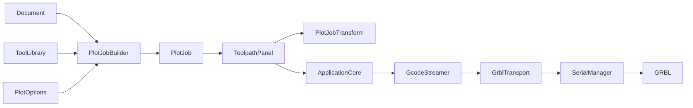
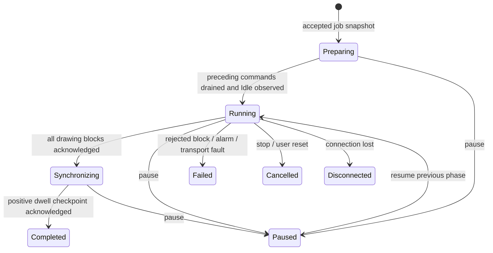

# Current architecture

Updated 2026-10-04 after the architecture review. This describes the implemented boundaries; `Architecture_and_Core_Implementation.md` is the earlier implementation walkthrough and contains historical API examples.

## Build modules

| Target | Owns | Direct dependencies |
| --- | --- | --- |
| GcodeModel | Stateless G-code parsing, motion preview and geometric operations | Qt Core/Gui |
| PlotModel | Program blocks and job identity; source index, path ID, tool ID, kind and coordinate frame | Qt Core |
| CadCore | Entities, document, selection, undo commands, layers, vector fonts and text geometry | GcodeModel, Qt Core/Gui/Core5Compat; OpenCV for stroke conversion |
| CadTools | Interactive drawing/edit tools, including the text editor dialog | CadCore, Qt Widgets |
| PlotEngine | ToolLibrary, passive pen-rack macro compiler, PlotJobBuilder, RackJobValidator and PlotJobTransform | CadCore, PlotModel, GcodeModel |
| GrblBackend | Transport interface, serial adapter, FIFO accounting, job controller, response/state parsing and file I/O | PlotModel, GcodeModel, Qt SerialPort |
| ImportServices | Image vectorization and DXF parsing | CadCore, OpenCV |
| ApplicationServices | ApplicationCore service lifetime/wiring and application settings | GrblBackend, PlotEngine |
| GrblUi | Widgets, windows, dialogs and asynchronous previews | ApplicationServices, ImportServices, CadTools, Qt Widgets/Concurrent |

The executable composes these modules. Tests link the same libraries, and widget resources attach to the executable targets. Qt private headers are not required.

## Drawing and program ownership

`Document` owns the editable CAD graph, layer table, selection and command history. Entity implementations provide local geometry; `PlotJobBuilder` owns plotting policy. It recursively selects enabled, visible drawable leaves, resolves the document default tool, validates the injected tool library and supported Pen type, applies the separate plunge feed and emits explicit work-coordinate modes. Invalid designs return errors instead of executable output. The legacy `Document::generateGcode` entry point delegates to this builder in PlotEngine.

`ToolDefinition` contains stable ID, name, availability, `ToolKind` (currently Pen) and preview color. `PenRackStation` contains docking position, macros and calibration, stored separately by tool ID in the current settings facade, `ToolLibrary`. Changing identity/display metadata does not edit the station; station motion edits invalidate its calibration. `ToolsDialog`, path assignment/default controls and toolpath filtering use Tool terminology. Plotting and passive pen-rack behavior retain explicit Pen terminology. This physical tool model is distinct from the CAD editor's interactive Line/Trim tools; [CONTEXT.md](../CONTEXT.md) records the vocabulary.

Settings write `tools` with explicit `kind` and `previewColor`, accept legacy `pens` and `color` only when the current fields are absent, and preserve UUIDs and station calibration. The legacy nested rack envelope is decoded into the separate station map and retained on serialization for round trips. Unsupported kinds and malformed definitions are rejected without partially replacing the library. A future operation/machine-profile model is deferred until another process is implemented; see [ADR 0002](decisions/0002-generic-tool-definitions.md).

`PlotJob` owns program text as well as geometric identity. `ToolpathPanel` keeps that typed job when displaying generated designs. Preview parsing runs asynchronously on copied input; each result has a generation token so that a replaced/cleared/transformed program cannot receive stale geometry. The controller copies the selected job at start, and the UI disables program edits/replacement while it is active.

`PlotJobTransform` validates the entire program before rewriting drawing coordinates. It preserves non-motion blocks, original feed/modal semantics, auxiliary words, comments, block identities and source indices. Metric absolute XY programs are supported. Unsupported modes, work-frame switches and rack/machine-coordinate programs remain viewable but cannot use drawing transforms. Circular arcs require uniform scaling; radius-form arcs retain their scaled radius. Generated setup and finish blocks remain fixed.

## Commands and lifecycle

`GcodeStreamer` is the job controller; its retained name is a compatibility choice. All ordinary UI commands enter through ApplicationCore and this controller. Each submission has a unique ID, origin (Job/Manual/System), job identity and source index. Manual/configuration batches use simple send-response; motion batches also receive a synchronization checkpoint. Startup queries do not issue a motion checkpoint in Alarm. Jog acknowledgements wait for a fresh Idle report before the next ordinary command. Realtime status/hold/resume/reset/jog-cancel remain a separate transport operation.

`GrblCommandQueue` owns FIFO identities and the 127-byte receive-capacity budget, including newlines. `SerialManager` uses it for its waiting and in-flight queues. Clearing waiting commands preserves outstanding acknowledgements and accounting; reset/disconnect clears the complete session. Responses pop the oldest in-flight identity and route its result to the controller. Unknown/duplicate completions cannot advance a job. Port I/O is asynchronous on the owning QObject thread.

Resume restores the phase preceding pause (Preparing, Running or Synchronizing); the diagram abbreviates that transition. Preparation has a bounded timeout. The first failure stops submission, removes waiting work, invalidates holder knowledge and resets buffered motion. Cancel and disconnect are separate terminal outcomes. Success is emitted only after the final `G4 P0.01` acknowledgement, because ordinary motion acknowledgements can precede physical completion. Progress means **acknowledged source line**, not measured physical position. `MachineState` is updated through setters for real alarms; a rejected command does not fabricate an Alarm state.

The serial adapter destructor relies on QObject ownership of its port/timer and does not access sibling state models during teardown.

## Undo boundaries

Imports use one CompositeCommand. Add, update and delete commands retain UUIDs rather than assuming indices remain stable. Layer creation/removal/rename/visibility/lock/color changes use EditLayersCommand; removal also snapshots nested entity layer references and the active layer. Active-layer selection itself remains a UI selection operation. Raw document mutators remain command/loading primitives; user edits should go through commands or the import transaction.

## Multi-pen execution boundary

The user has confirmed a passive rack. `ToolChangeMacroCompiler` produces bounded explicit machine-coordinate motion independent of transport. `PlotJobBuilder` can assemble complete automatic jobs in drawable path order, coalescing adjacent pen assignments. The job carries a configuration fingerprint, execution seal, initial holder expectation, pen sequence, work bounds, phase labels, synchronization blocks and holder effects. Settings snapshots are checked at Start and the controller copies the program for execution.

Design keeps Generate available for mixed-tool and automatic-rack designs so it can resolve generation setup. When needed, the action asks for an explicit initial-holder selection and enables automatic exchanges after acceptance. It rebuilds and validates the complete job before emission; cancellation and validation errors emit nothing. Single-tool manual generation stays a one-click action. Physical setup confirmations and calibration preflight remain part of Start.

ApplicationCore installs a RackJobValidator callback in the controller, preserving the backend's independence from CAD and PlotEngine. The validator requires calibrated rack/stations, current machine coordinates and complete selected WCS/G92/TLO offsets, and checks transformed work bounds and raised clearance. GrblParser tracks coordinate validity; reset/disconnect and offset-changing commands invalidate cached values. GcodeStreamer also requires Idle/readiness, session homing confirmation, matching known holder contents, program integrity and whole-job execution. Operator setup explicitly confirms rack occupancy and shared pen heights.

The controller buffers Drawing blocks and drains pending work before each Rack/Setup/Finish/Synchronization block. Rack commands are submitted one at a time; positive G4 acknowledgements gate subsequent phases and commit Empty/Loaded holder effects only after retraction. Phase deadlines allow feed override and suspend during intentional pause. Any interruption invalidates holder/homing confidence and stops queued execution without an automatic rack return. Holder tracking describes the expected passive mechanism state; it has no physical pickup sensor.

The toolpath preview filters automatic rack commands while preserving source indices, so machine-coordinate rack motion cannot be mistaken for work-frame drawing. Export/range/legacy-origin controls and drawing transforms are unavailable for managed jobs. Configuration edits require regeneration; motion-setting edits clear calibration. See [proposal 0001](proposals/0001-automatic-passive-rack-exchanges.md) and [ADR 0001](decisions/0001-managed-passive-rack-jobs.md).

## Verification

`CTest` runs TestGcodeParser, TestCanvasSnap, TestPenAssignment, TestToolChangeMacro, TestArchitectureRegression, TestJobController, TestPlotPipeline, TestAutomaticRack, TestRackExecution, TestAutomaticRackUi, TestGcodePenColors, TestToolpathPenColors, TestToolFilter and TestToolLibrary. Tests use offscreen Qt widgets and simulated transport only. Controller coverage includes command ownership, buffer limits, final synchronization, rejection, reset/cancel/disconnect, pause/resume, preparation timeout, jog handoff, startup in Alarm and reentrant acknowledgements. Plot/document coverage includes feed selection, tool validation, program preservation, unsupported transforms, import transactions and layer undo. Automatic coverage includes ordered exchanges, holder commit timing, failure injection at every non-drawing block, bounds/calibration/configuration preflight, coordinate validity, setup UI and application integration. Architecture coverage includes stale preview isolation, control states and application teardown. Shared UI coverage includes color rendering, original-index tool filtering, migration to typed tool definitions and independent station calibration.
