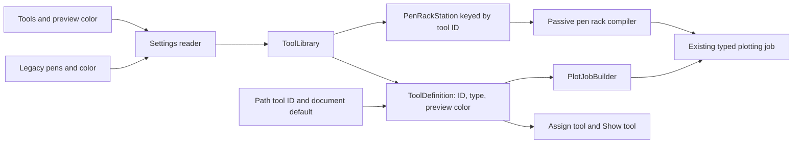

# 0002 — Generic tool definitions with pen plotting

**Date:** 2026-10-04
**Status:** Accepted
**Author:** Codex
**Related ADRs:** [0002](../decisions/0002-generic-tool-definitions.md)

## Problem Statement

Shared path assignments already use stable tool IDs, but PlotterToolProfile combines identity and color with machine-specific pen rack stations. Shared UI labels use Pens, making a future second process require changes throughout assignment and preview code. The user has accepted Tool as the common concept with Pen as its currently supported type. Existing designs, plotting output and calibrated rack motion must remain usable.

## Proposed Solution

Introduce ToolDefinition and ToolLibrary in the existing settings/model target. ToolDefinition owns ID, name, enabled state, ToolKind (Pen only), and previewColor. PenRackStation owns the existing slot, contact heights, motion templates and calibration fields, stored by tool ID separately from the definitions. ToolLibrary retains the existing settings facade and its global PenRackSettings for this machine; a separate machine-profile subsystem is deferred until required.

Rename the shared editor to ToolsDialog and shared assignment/default/filter controls to Tool. Keep process-specific plotting options, passive rack compiler, safety checks, pen-up/down terminology and operator confirmations. No milling tool is offered or accepted by persistence. The current builder and exchange compiler continue to accept only the supported Pen type.

Settings write tools rather than pens. Each definition serializes kind=pen and previewColor. The existing nested rack payload is retained as a compatibility envelope but decoded into the separate station map; this keeps library round trips and rack settings intact. Readers accept legacy pens/color and records without kind as Pen, prefer explicit tools/previewColor when present, and reject unknown or malformed types without replacing the library. UUIDs and design serialization remain unchanged. Configuration fingerprints use the canonical normalized representation so legacy and current records describing the same setup match after loading.

## Alternatives Considered

### Keep pen-specific shared names
Smallest immediate change, but leaves the already accepted Tool/Pen distinction ambiguous in the shared model and UI.

### Rename the profile while retaining rack fields
Easy mechanical change, but couples every future tool definition to passive pen docking requirements.

### Introduce machining operations and a machine-profile subsystem now
Would model future milling more fully, but adds unsupported process behavior and a much larger migration before a second process is required.

## Impact Assessment

| Area | Impact | Notes |
|---|---|---|
| Persistence | Migration | tools/previewColor/kind, legacy reading; station payload retained |
| C++ contracts | Renamed model and editor | Consumers explicitly use ToolDefinition and station lookup |
| Frontend | Shared terminology | Tools, Assign tool, Default tool, Show tool; Pen type is visible |
| Tests | Migration and integration coverage | IDs, station calibration, filtering, generated commands and rejected types |
| External API | None | No new integrations |
| Infrastructure | None | No new dependencies |
| Observability | None | Existing errors and phase status |
| Security | Existing validation retained | Unsupported types cannot be treated as pens |

## Open Questions

None for the accepted focused refactor. Milling operations and machine profiles are future work.

## Acceptance Criteria

- Shared code uses ToolDefinition/ToolLibrary, with Pen as the only supported ToolKind.
- Rack station fields are absent from ToolDefinition and station edits retain calibration invalidation.
- Legacy definitions load with identical IDs, names, colors, enabled state, station settings and calibration.
- New settings write tools/kind/previewColor; explicit current keys take precedence over legacy keys.
- Unknown tool types and malformed colors/stations are rejected atomically.
- Shared UI exposes Tools, Assign tool, Default tool and Show tool and identifies the supported Pen type.
- Generated plotting/rack commands, design assignments, Undo/Redo, color rendering and filter line mappings retain existing behavior.
- Debug and Release builds and all CTest suites pass.
